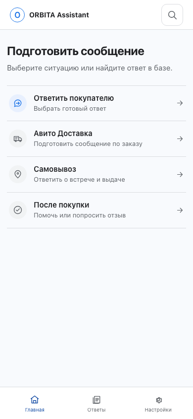
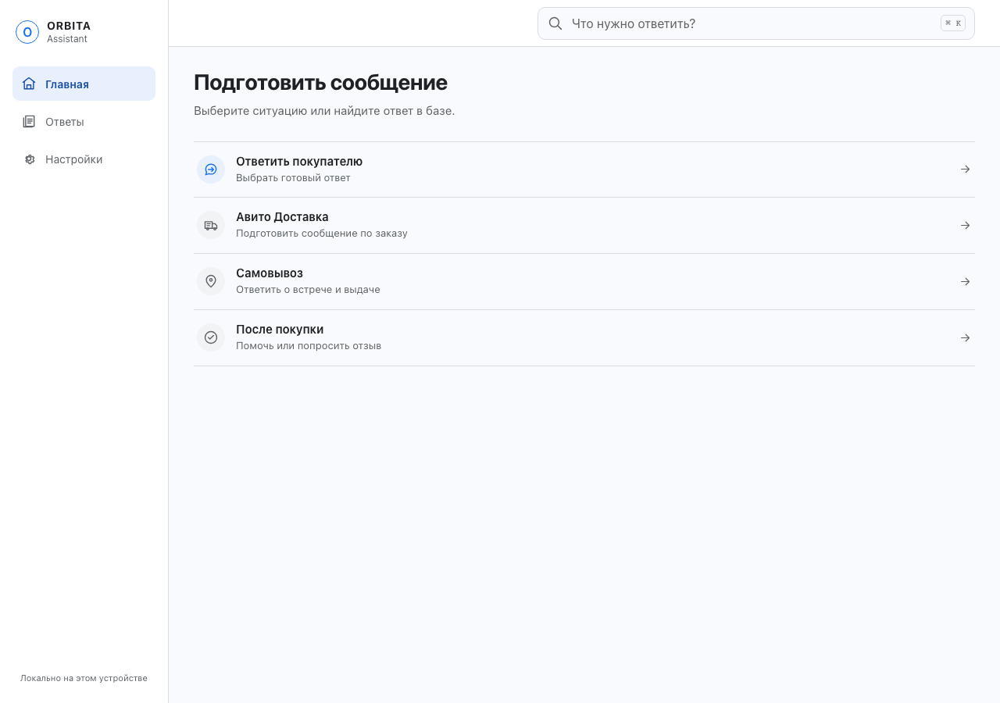
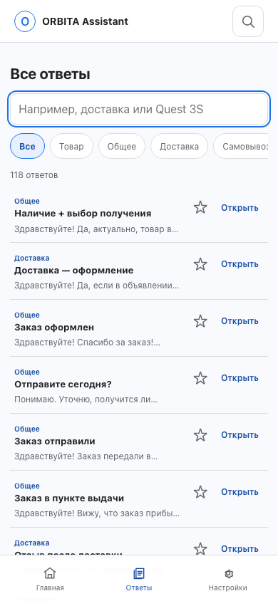
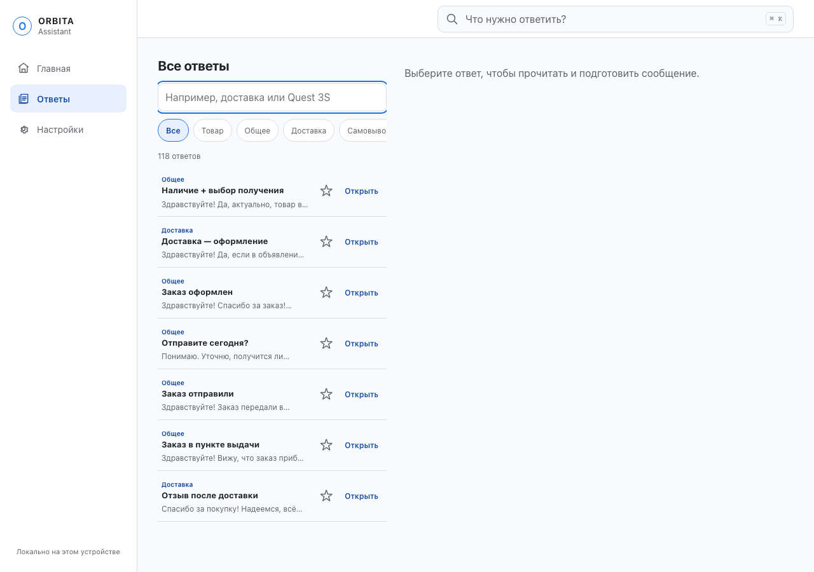
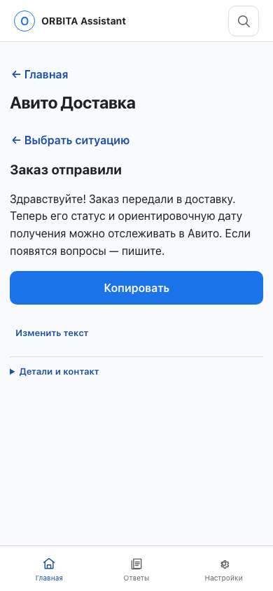
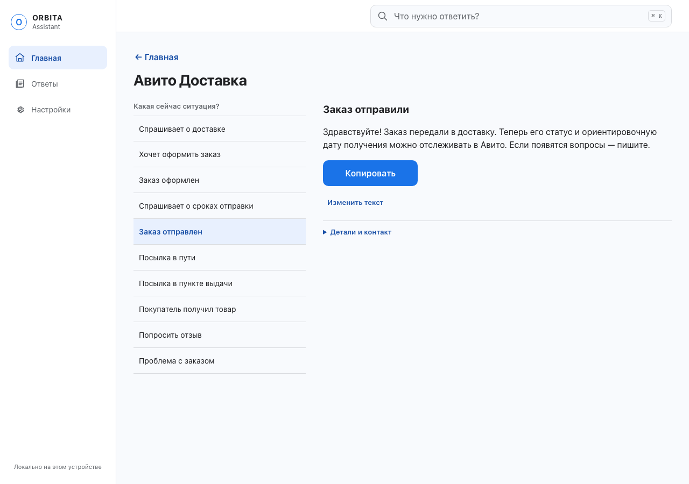
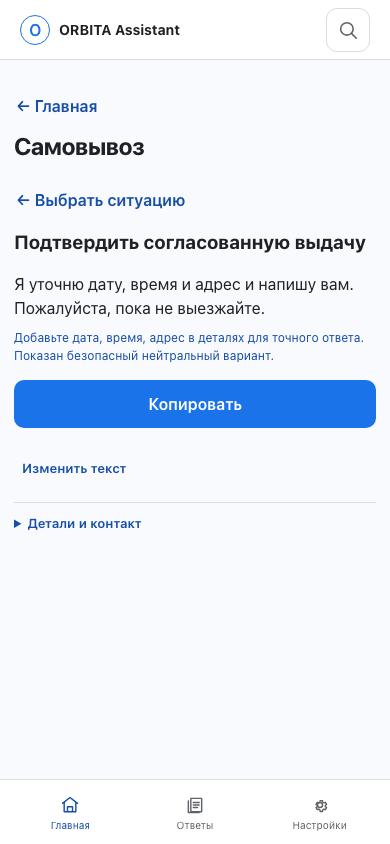
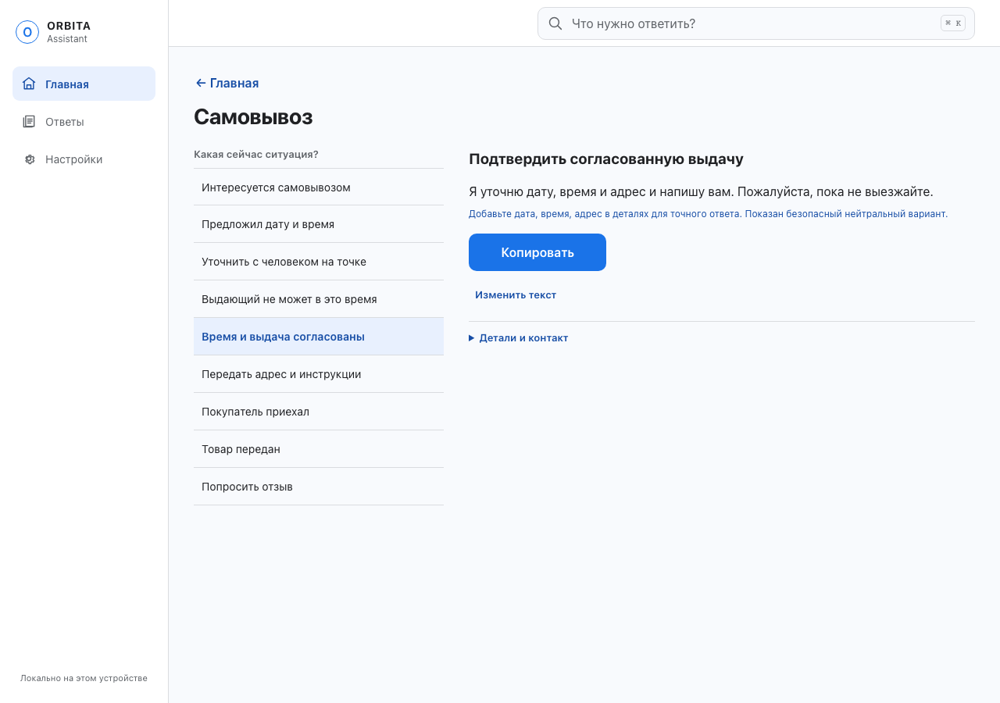

# ORBITA Assistant 1.3 — цветовая система

Интерфейс использует холодную палитру: фон `#F8FAFD`, поверхности `#FFFFFF`, текст `#202124` / `#5F6368`, границы `#DADCE0`, выбор `#E8F0FE` и синий акцент `#1A73E8`. Акцентный текст на выбранном фоне затемнён до `#174EA6` для контраста. Красный и зелёный оставлены только для ошибок и статуса успеха.

Проверки production-сборки: 102 unit-теста, 22 Chromium E2E-теста, axe WCAG A/AA, offline reload service worker, manifest и метаданные PWA, публичные данные, бюджет и сборка. Lighthouse mobile: Performance 100, Accessibility 100, Best Practices 96, SEO 100; FCP 1.4 s, LCP 1.7 s, Speed Index 1.4 s, TBT 0 ms, CLS 0.

## Скриншоты

Снимки сделаны Playwright из production preview при 390×844 и 1280×900. Для повторного снятия используйте `node scripts/capture-workspace-palette-screenshots.mjs`.

| Экран | Мобильный | Desktop |
| --- | --- | --- |
| Главная |  |  |
| Ответы |  |  |
| Доставка |  |  |
| Самовывоз |  |  |
